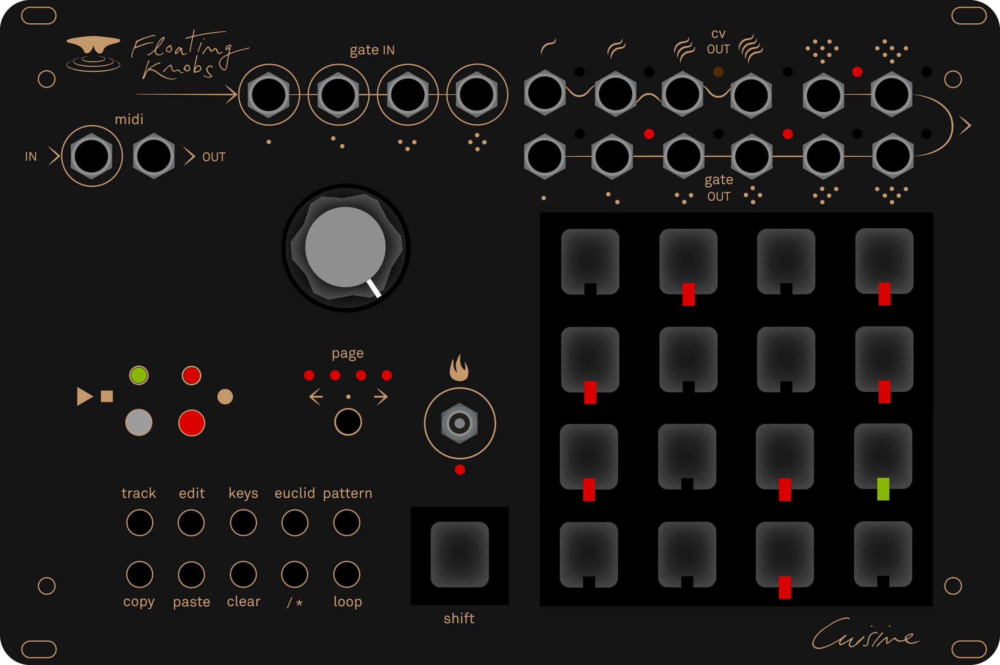

# Cuisine



An open-source twelve-track Eurorack step sequencer, and the hardware SDK it is
built on. Everything is edited from the panel.

## The instrument

Twelve tracks, each a voice with its own clock, scale and output routing. A track
is one of three types — **NOTE** (pitch on CV), **MOD** (a value on CV) or
**DRUM** (a trigger) — which changes what a step means and what comes out.

Sixteen banks, twelve patterns per track, four pages per pattern, scales,
arpeggiator, Euclidean rhythms, 4 CV outputs, 8 gate outputs, MIDI in and out.
The firmware fits in the 48,640 B of usable flash on an ATmega4809, with about
3.3 KB of RAM in use.

Hardware, demos and the manual live at
[floatingknobs.com](https://www.floatingknobs.com/product-page/cuisinette).

## What is in this repository

| path | what it is |
|---|---|
| `lib/cuisine/` | **the SDK** — the hardware layer, version 1.0.0, usable on its own |
| `src/`, `include/` | **the sequencer** — the reference application built on it |
| `docs/` | this project's documentation |

## Getting started

**1. Install the toolchain** (once)

| | |
|---|---|
| Git | [git-scm.com](https://git-scm.com/downloads) — to clone and update |
| PlatformIO IDE extension | installs `pio` and the AVR toolchain on first use |
| CH340 driver | the board's USB-serial chip; Windows usually needs it |

The full walkthrough, including drivers and troubleshooting:
[`docs/setup.md`](docs/setup.md).

**2. Get the code**

```
git clone <repository-url>
```

Downloading the ZIP works too, but then updating means downloading it again.

**3. Open the folder** containing `platformio.ini` in your editor and accept the
PlatformIO prompt. It installs the `atmelmegaavr` platform, which takes a few
minutes the first time.

**4. Build and flash**

```
pio run -e ATmega4809 -t upload --upload-port COM5
```

`pio device list` shows the port, and it changes when the board is replugged. The
production image is silent on serial by design — flash `bench` instead if you
want the board to answer:

```
pio run -e bench -t upload --upload-port COM5
```

## Two ways in

This repository holds a library and a complete application built on it. Pick the
path that matches what you want to own.

| | build on the SDK | fork the instrument |
|---|---|---|
| time to first sound | minutes | an afternoon of reading |
| features at the start | none — you build them | everything: 12 tracks, banks, scales, arp, Euclid |
| surface to learn | 12 modules | ~6,600 lines of application |
| upgrading later | SDK 1.x is stable, you pull updates | you own the diff |

### Build on the SDK

For a new instrument, or anything that is not a sequencer.

1. Create a PlatformIO project — or copy `lib/cuisine/` into one you already have.
2. `#include <cuisine.h>`, call `begin()` once and `poll()` every loop.
3. Start from the thirty-line application in
   [`lib/cuisine/README.md`](lib/cuisine/README.md) — it compiles as printed.
4. Keep [`lib/cuisine/docs/api.md`](lib/cuisine/docs/api.md) open.

You get eleven hardware blocks behind a versioned API and nothing else: no
patterns, no tracks, no UI. You own every decision above the hardware —
including your own clock model, if the master timebase is not enough.

### Fork the instrument

For changing the sequencer itself: a new page, a different data model, another
play mode.

1. Build and flash it first, and spend ten minutes at the panel.
2. Read [`docs/sequencer/architecture.md`](docs/sequencer/architecture.md) — the
   loop order and the four invariants there are load-bearing.
3. Then edit by responsibility:

   | change | file |
   |---|---|
   | a page, a key combination, an LED behaviour | `src/interface.cpp` |
   | per-track data, timing, saving | `src/track.cpp`, `include/structDefinition.h` |
   | what an output does | `src/eventManager.cpp` |
   | a new hardware block | `lib/cuisine/` |

4. Keep the `static_assert`s in `structDefinition.h` intact — they protect data
   users have already saved.

You inherit tracks, patterns, banks, three track types, scales, arpeggiator,
Euclidean rhythms and the whole panel. The trade: the application is not
versioned, and it is not a pure SDK consumer — it calls SDK classes directly in
about 29 places, so an SDK 2.0 could break it.

### Mixing the two

`include/trackClock.h` and `.cpp` — 74 lines — are the sequencer's per-track
clock: source, division, offset, play mode. They are **not** part of the SDK.
Copy them into an SDK project to get that behaviour without inheriting 6,600
lines of UI.

Both paths are GPL-3.0-or-later: whatever you build on them must be too.

## Documentation

| document | what it covers |
|---|---|
| [`docs/setup.md`](docs/setup.md) | from a bare computer to a flashing board: git, editor, PlatformIO, drivers |
| [`docs/hardware.md`](docs/hardware.md) | the board: pins, SPI bus and measured speeds, panel wiring |
| [`docs/firmware.md`](docs/firmware.md) | build, flash, the bench serial protocol, debugging without a debugger |
| [`docs/conventions.md`](docs/conventions.md) | the rules the code follows, and why |
| [`docs/sequencer/`](docs/sequencer/README.md) | what the sequencer is, its pages, data layout and architecture |
| [`lib/cuisine/README.md`](lib/cuisine/README.md) | the SDK, from zero to a working application |
| [`lib/cuisine/docs/api.md`](lib/cuisine/docs/api.md) | the API reference, one section per module |
| [`lib/cuisine/CHANGELOG.md`](lib/cuisine/CHANGELOG.md) | what changed, and what the version numbers mean |

## Status

Firmware and SDK are both at 1.0.0. There is no CI and no unit test suite:
verification happens on the board, and commit messages say what was flashed and
what was observed.

This is a spare-time project: issues are read, but there is no promise of a fix,
and pull requests are not actively reviewed.

## Licence

GNU General Public License v3.0 or later — see [LICENSE](LICENSE).

Free to use, study, share and modify. If you distribute a product built on this
code, the GPL requires you to publish your source under the same licence.
